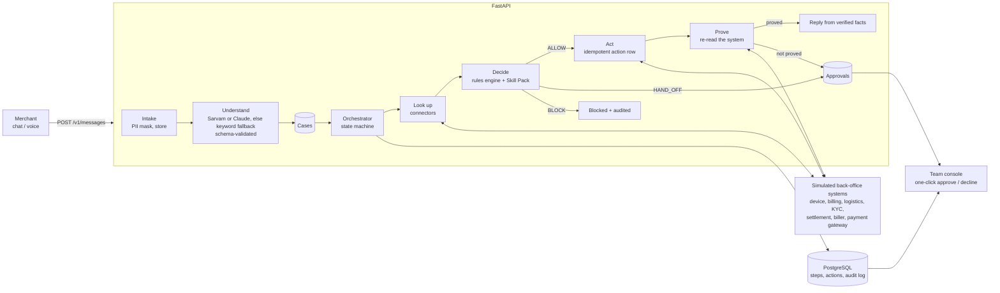
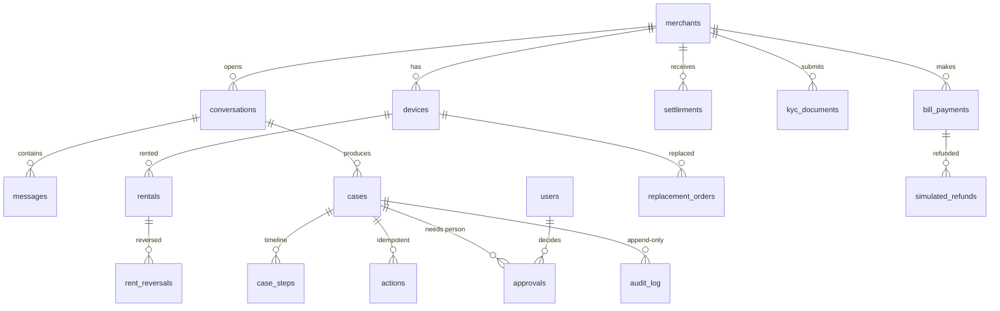

# Architecture

## One idea: the AI never decides

Saathi is a case-resolution engine. A language model may *label* a message; it never chooses an
action. Everything that moves money or changes a system passes through a deterministic rules engine
that reads a Skill Pack, and every action is re-checked against the system of record before a case closes.



## Case state machine

`OPEN → IN_PROGRESS → WAITING_MERCHANT | AWAITING_APPROVAL | RESOLVED | BLOCKED | FAILED`,
`AWAITING_APPROVAL → RESOLVED | REJECTED`. Transitions are validated (`app/domain/types.py`);
terminal states have no outgoing edges. OPEN→IN_PROGRESS is an atomic `UPDATE ... WHERE status='OPEN'`,
so a case cannot be worked twice even if a job runs twice.

## Safety properties (each has a test)

| Property | Mechanism | Test |
|---|---|---|
| Limits live in code | `rules/engine.py` + Skill Pack YAML | `test_rules_engine.py` (₹500 / ₹500.01 boundary) |
| Instruction in a message cannot move money | `injection_suspected` → `BLOCK`; LLM output also re-checked | `test_fake_refund_instruction_is_blocked_and_logged` |
| An action cannot run twice | `actions.idempotency_key` UNIQUE + connector-level keys | `test_a_case_cannot_be_processed_twice`, connector idempotency tests |
| Never closes on the AI's word | Prove step re-reads the system; failed proof → person | `test_gateway_failure_escalates_instead_of_claiming_success` |
| Audit log cannot be edited | Postgres trigger rejects UPDATE/DELETE | `test_audit_log_is_append_only` |
| Unexpected error never crashes a case | worker catches, escalates with `system_error` | `test_unexpected_error_escalates_instead_of_crashing` |
| PIN/OTP/card never stored or sent to a model | `ai/pii.py` masks before storage and before the LLM | `test_pii_masking`, `test_shared_otp_is_masked_in_storage_and_warned` |
| Approvals decided once, by the right role | atomic status update; role dependency | `test_approval_cannot_be_decided_twice`, `test_agent_cannot_approve_but_risk_can` |

## Data model



The last eight tables (`devices` ... `simulated_refunds`) stand in for Paytm's internal systems and are
only reached through the `Protocol`s in `app/connectors/base.py`.

## Module map

```
api/app/
  api/            HTTP: routes (console + merchant-facing), merchant dashboard API, schemas, auth, health
  ai/             understand (Sarvam or Claude + keyword fallback), PII masking, prompts, output schema
  rules/          the rules engine (pure functions)
  skillpacks/     YAML packs + loader/validation
  services/       orchestrator, playbooks per product, actions (act+prove), replies, metrics
  connectors/     Protocols + simulated implementations
  domain/         enums + the case state machine
  db/             SQLAlchemy models, session
  eval/           labelled message sets + runner
web/
  app/            /, /login, /app/* (merchant dashboard), /console/* (team), /chat (embeddable), /embed-demo, /api/demo/session
  components/     UI primitives, timeline, approval card, chat panel, status card
  lib/            typed API client, auth store, SSE hook, speech hook, i18n
  public/saathi-widget.js   the <saathi-widget> web component
```

## Real-time

New case steps are written to Postgres as they happen. `GET /v1/cases/{id}/stream` (SSE) tails that table,
so it works across multiple API workers with no broker. The merchant chat polls (700 ms while working,
2 s idle) because a chat only needs the next message, and polling needs no connection state.

## The merchant dashboard is just another consumer of the systems of record

`services/merchant_view.py` builds the dashboard's read models (overview, devices, settlements, bills, one money ledger,
help requests) from the same tables the simulated back-office systems write. Nothing is wired from Saathi to the
dashboard: when Saathi reverses rent, creates a replacement, refunds a bill or a person releases a hold, the dashboard
shows it because the underlying system changed. Help-request steps shown to merchants exclude rule internals and evidence.
Alerts carry a pre-written message in the merchant's own language, so "Resolve with Saathi" is one click.

## Auth

* Staff: email + scrypt-hashed password → HS256 JWT (`scope=staff`, role). Roles: AGENT (read), RISK_APPROVER, ADMIN.
* Merchants (standalone dashboard): email + scrypt-hashed password via `POST /v1/merchant/login`.
* Merchants (embedded in another host): never log in to Saathi. The host's backend calls `POST /v1/embed/token` with a host
  key and gets a 30-minute `scope=merchant` token. Both produce the same kind of token. Scopes do not cross.
* Login is rate-limited per IP+email (10/min) and per IP (60/min); messages 20/min per merchant. These
  limiters are in-process; use Redis if you run more than one API instance.
